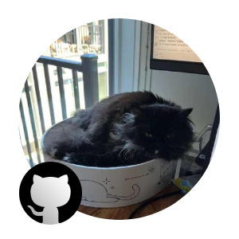

# Hello!

I build tools, tracks, and mods for **Re-Volt / RVGL**, and I reverse-engineer how it works. I mostly write C++, with some Python and web stuff on the side.

## My GitHub Projects

| Project | What it is | Stack |
|---|---|---|
| [**XMenu RVGL Chaos**](https://sinaosal.github.io/rvgl-projects/) | Trainer menu and Chaos Mod for RVGL 23.1030a1. Based on ZMenu RVGL. | RVGL mod |
| [**RVGL Reverse Engineering**](https://github.com/sinaosal/RVGL-Reverse-Engineering) | Notes and Ghidra project files documenting RVGL internals. | Ghidra |
| [**Re-Volt Font**](https://github.com/sinaosal/Re-Volt-Font) | The Re-Volt font as `.otf` / `.ttf`, in low-res (original) and high-res (RVGL) versions. | Fonts |
| [**Nitrod**](https://github.com/sinaosal/Nitrod) | Work based on Nitrox, the open-source Subnautica multiplayer mod. | C# |
| [**Re-Volt Track Editor Redux**](https://github.com/sinaosal/Re-Volt-Track-Editor-Redux) | Remake of the Re-Volt Track Editor (original by Dummiesman). Adds a new Studio interface, a race-data editor (AI nodes, zones, pickups, lights), autosave, and Android support. | C#, Unity |

## Contributions

| Project | What it is | Stack |
|---|---|---|
| [**Re-Volt America (RVA)**](https://github.com/Re-Volt-America/RVA) | Website and backend of Re-Volt America. (Thank you BGM!) | Ruby on Rails, JavaScript |

## Tools I use

C++, Unity, Python, HTML/CSS, Ghidra, Ruby on Rails

## Find me

- **Website:** [sinaosal.app](https://sinaosal.app/)
- **GitHub:** [sinaosal](https://github.com/sinaosal)
- **GitLab:** [sinaosal.prm](https://gitlab.com/sinaosal.prm)
- **Re-Volt World:** [sinaosal](https://www.revoltworld.net/user/sinaosal/)
- **Discord:** `sinaosal.prm`
